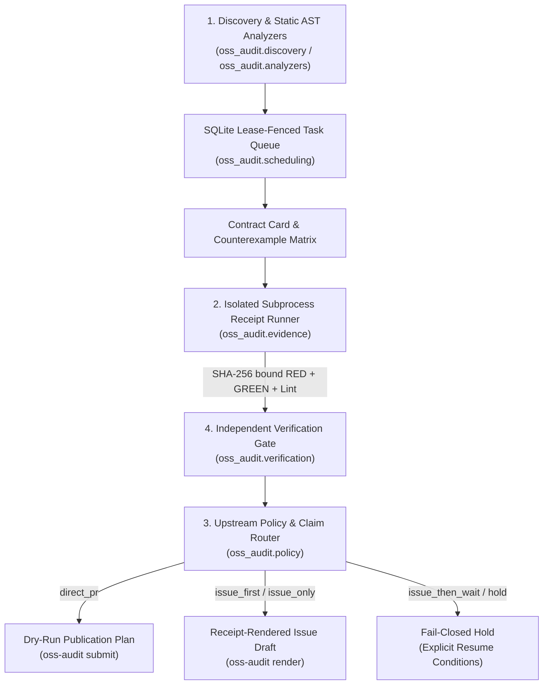

# oss-audit

[](https://github.com/Starchaser1024/oss-audit/actions/workflows/ci.yml)

**Evidence-Driven Open-Source Defect Verification & Policy-Aware Triage Pipeline**

`oss-audit` is a zero-runtime-dependency Python engineering framework built to eliminate hallucinated, unverified, or duplicate AI-generated pull requests in open-source software. Rather than treating LLM prose or static heuristics as proof of a bug, `oss-audit` enforces four deterministic verification boundaries before any issue or pull request plan can be produced:

1. **Static AST & Contract Asymmetry Analysis** — Identifies multi-implementation `Protocol`/`ABC` divergences ("$N - 1$ paths guarded"), sync/async exception-handling asymmetries, and broken `from_dict(cls, ...)` subclass factories as bounded investigation leads.
2. **Reproducible RED -> GREEN Execution Receipts** — Runs isolated subprocesses that bind Git commit SHAs, file and lockfile SHA-256 digests, runtime module `__file__` import provenance, JUnit XML assertion failures, and per-node `pytest` outcomes to an append-only journal. Zero-test runs, skips, collection errors, shadowed imports, and tampered counts fail closed.
3. **Upstream Policy & Claim Collision Router** — Evaluates pinned `CONTRIBUTING.md` snapshots alongside complete-pagination GitHub read checks (`FREE` / `TAKEN` / `UNKNOWN`) and active-PR collision queries to route candidates to `direct_pr`, `issue_first`, `issue_then_wait`, `issue_only`, or `hold`.
4. **Independent Falsification Gate & Counterexample Replay** — Enforces explicit production contract provenance (*a failing test written by the investigator is never itself a product contract*), normal-behavior preservation on base and patched revisions, cryptographic reviewer bundle binding, and historical counterexample replay to reject overfitted word-lists or determiner heuristics (`confirmed` vs. `excluded`, `covered_upstream`, `design_tradeoff_issue_only`, and `insufficient_evidence`).

---

## Scope Boundaries & Non-Goals

- **Falsification & Maintainer Signal Over Volume** — Blocking an overfitted heuristic patch (`excluded`), catching an upstream fix opened minutes earlier (`covered_upstream`), or routing an uncontracted trade-off to `issue_only` is treated with the same rigor as merging a fix. Post-review `maintainer_feedback` entries feed directly back into future triage and lint rules.
- **Bounded Local Workspace Queue, Not Unattended Mass Scanning** — `oss_audit.discovery` and `oss_audit.scheduling` coordinate bounded local Git worktrees and single-host SQLite leases for human-reviewed engineering investigations. The package contains **zero GitHub write primitives** (`oss-audit submit` emits dry-run preflight plans only) and never operates as an automated PR-publishing bot.
- **Source-Level Contract Proof vs. Live HTTP Runtime Verification** — `oss-audit` proves offline source-level contracts, AST/protocol invariants, isolated `pytest` `RED -> GREEN` receipts, and upstream `CONTRIBUTING.md` governance prior to proposing a patch, complementing dual-environment HTTP runtime regression verifiers (such as `change-verifier`) that compare live baseline vs. candidate service deployments over replayed API traffic.

---

## Architecture Overview



See [docs/ARCHITECTURE.md](docs/ARCHITECTURE.md) for the complete system design, lease-fencing state machine, receipt tamper boundaries, and module contracts.

---

## Package Structure

```text
oss-audit/
├── oss_audit/
│   ├── core/            # Dynamic workspace paths (OSS_AUDIT_HOME), atomic JSON I/O, host resource limits
│   ├── discovery/       # Topic/inventory discovery, call-site reachability, explainable shadow scoring
│   ├── analyzers/       # Protocol/ABC contract auditor, sync/async guard asymmetry & from_dict AST scanners
│   ├── policy/          # Pinned CONTRIBUTING router, FREE/TAKEN/UNKNOWN claimcheck, collision & submit gates
│   ├── evidence/        # Isolated pytest harness, runtime __file__ provenance, SHA-256 receipt validator
│   ├── verification/    # Bundle & dossier falsification verifier, counterexample replay, metrics, renderer
│   ├── scheduling/      # SQLite WAL queue, PID+creation-time lease fencing, bounded tick coordinator
│   └── cli.py           # Unified `oss-audit` / `python -m oss_audit` command-line interface
├── policies/
│   └── repos.json       # Commit-pinned upstream contribution rules and deterministic routing samples
├── config/
│   └── pipeline.json    # Worker concurrency, lease TTLs, resource watermarks, and quota configuration
├── examples/            # Verified upstream issue reports, PR writeups, and issue-only routing artifacts
├── docs/                # Architecture, evidence schema, policy routing, and scheduler specifications
└── tests/               # 157 unit and subprocess integration tests + pinned counterexample & dossier fixtures
```

---

## Quick Start

### Installation

Requires **Python 3.11+** and `git`. Core scheduling, policy routing, AST analysis, and counterexample verification use only the Python standard library; `pytest` and `ruff` are used for running the test suite and subprocess receipt harness.

```bash
python -m venv .venv
# Linux / macOS
source .venv/bin/activate
# Windows PowerShell
.\.venv\Scripts\Activate.ps1

python -m pip install -e ".[dev]"
```

### CLI Usage Examples

All subcommands resolve paths dynamically from `--workspace`, `OSS_AUDIT_HOME`, or the repository root, working identically on Linux, macOS, and Windows:

```bash
# Inspect all unified subcommands
python -m oss_audit --help

# Verify pinned upstream policy routing rules (direct_pr, issue_first, issue_then_wait, issue_only, hold)
python -m oss_audit policy --check-samples

# Replay 13 counterexamples across 4 real historical selector revisions (3 naive versions rejected, 1 accepted)
python -m oss_audit verify --suite historical-counterexamples

# Audit candidate investigation dossiers (confirmed fixes + excluded/prevented leads & feedback rules)
python -m oss_audit verify --suite candidate-falsification
python -m oss_audit dossier summary

# Run static AST analyzers on a local repository checkout
python -m oss_audit scan ./path/to/repo --mode contracts
python -m oss_audit scan ./path/to/repo --mode async-guards
python -m oss_audit scan ./path/to/repo --mode from-dict

# Check upstream issue/PR claim and duplicate collision status (GET-only via `gh api`)
python -m oss_audit claimcheck bytedance/deer-flow#7598
python -m oss_audit collision deepset-ai/haystack --query "filter_documents_async" --query "MockedDocumentStore"

# Execute an isolated, dry-run bounded audit pass in SQLite
python -m oss_audit tick --dry-run --workers 4 --repos 2 --max-minutes 10

# Execute a pytest spec to produce an immutable SHA-256 execution receipt and verify a full bundle
python -m oss_audit evidence run --spec spec.json --output ./runs/candidate-red
python -m oss_audit verify ./runs/bundle.json

# Run fail-closed preflight verification (generates dry-run plan; performs zero GitHub writes)
python -m oss_audit submit owner/repo --branch fix/example --title "fix: summary" --body-file pr.md --bundle bundle.json
```

---

## Real-World Validated Upstream Fixes

Every fix listed below was reproduced offline with deterministic `RED -> GREEN` regression suites, checked against upstream `CONTRIBUTING.md` policies and active community claims, reviewed, and **merged upstream** by project maintainers:

| Upstream Repository | Merged PR | Defect Class & Root Cause | Verification & Policy Route |
|---|---|---|---|
| `bytedance/deer-flow` | [#7140](https://github.com/bytedance/deer-flow/pull/7140) | **Credential Fallthrough Asymmetry** — Whitespace-only env token terminated lookup instead of falling through to valid `~/.claude/.credentials.json` | 5-input boundary matrix, +144 test lines (`direct_pr`, linked `#7139`) |
| `bytedance/deer-flow` | [#7462](https://github.com/bytedance/deer-flow/pull/7462) | **Container Path Rewrite Corruption** — `LocalSandbox.write_file` rewrote virtual `/mnt/...` paths inside non-executable `.md`/`.csv` deliverables | 21 sandbox + POSIX FIFO tests, 281 adjacent tests (`direct_pr`, linked `#7461`) |
| `bytedance/deer-flow` | [#7569](https://github.com/bytedance/deer-flow/pull/7569) | **Order-Dependent Secret Precedence** — `parse_required_secrets` and skill exporter dropped `optional=False` when preceded by an optional duplicate | 199 skill parser/exporter + 92 activation tests (`direct_pr`, linked `#7568`) |
| `agentscope-ai/agentscope` | [#3401](https://github.com/agentscope-ai/agentscope/pull/3401) | **DOCX Blank-Run Paragraph Collapse** — `WordParser` dropped blank paragraphs carrying whitespace or `<w:br/>` runs, merging adjacent chunks | 83 RAG parser tests + field-code counterexample (`issue_first`, `#3400`) |
| `agentscope-ai/agentscope` | [#3441](https://github.com/agentscope-ai/agentscope/pull/3441) | **Token-Budget Truncation Overflow** — Average character-density slicing let mixed-script tool outputs exceed `tool_result_limit` | Binary-search token recount + 50 lines of multi-script regressions (`issue_first`, `#3438`) |
| `agentscope-ai/agentscope` | [#3817](https://github.com/agentscope-ai/agentscope/pull/3817) | **OOXML Non-Breaking Hyphen Loss** — `WordParser` dropped `<w:noBreakHyphen/>` runs across paragraphs and tables | Paragraph + table run extraction regressions (`issue_first`) |
| `deepset-ai/haystack` | [#13381](https://github.com/deepset-ai/haystack/pull/13381) | **Async/Sync Protocol Asymmetry** — Three `run_async` retrievers called optional `filter_documents_async` unconditionally on sync-only `DocumentStore`s | Shared worker-thread fallback + 38 async retriever tests + CLA/reno (`issue_first`, `#13380`) |
| `ayuayue/PiDeck` | [#394](https://github.com/ayuayue/PiDeck/pull/394) | **Gateway Lookup Asymmetry** — `feishuSessionBotSet` queried single-runtime list instead of `CompositeAgentGateway`, failing on DSH sessions | 38 runtime binding tests + TypeScript typecheck against `dev` base (`direct_pr`, `#388`) |
| `langroid/langroid` | [#1124](https://github.com/langroid/langroid/pull/1124) | **Shared Mutable Default State** — `Task` instances mutated a shared default `TaskConfig` across independent agent runs | Cross-instance state isolation regression tests (`direct_pr`) |

Curated issue reports, PR writeups, and `issue_only` contract artifacts (such as [`Skyvern-AI/skyvern#9098`](examples/skyvern-split-pdf-token-budget/issue-report.md)) are available in [`examples/`](examples/README.md).

---

## Running Tests & Verification

```bash
# Run full unit and subprocess receipt integration suite (157 tests)
python -m pytest -q

# Replay historical counterexamples, candidate falsification suite, and policy routing checks
python -m oss_audit verify --suite historical-counterexamples
python -m oss_audit verify --suite candidate-falsification
python -m oss_audit policy --check-samples

# Lint codebase
python -m ruff check oss_audit tests
```

## Documentation

- [System Architecture & Verification Guarantees](docs/ARCHITECTURE.md)
- [Execution Receipt & Bundle Schema](docs/EVIDENCE-SCHEMA.md)
- [Upstream Policy Routing & Claim Collision Detection](docs/POLICY-ROUTING.md)
- [SQLite Lease-Fenced Queue & Bounded Scheduler](docs/SCHEDULING.md)
- [Curated Case Studies (`examples/`)](examples/README.md)

## License

MIT
