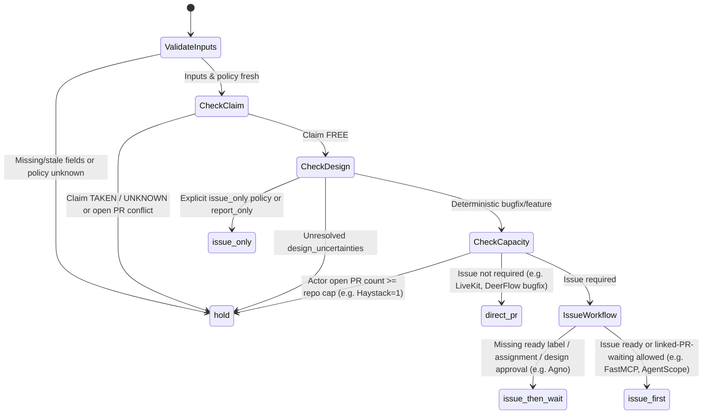

# Architecture & Verification Design

`oss-audit` is architected around a single engineering invariant: **automated analysis may propose leads, but only reproducible, cryptographically bound execution evidence and verified upstream policy rules can authorize a contribution plan.**

---

## 1. End-to-End Verification Pipeline

```mermaid
flowchart LR
    subgraph Stage1["Stage 1: Lead Discovery"]
        INV["repos.json + GitHub Search"] --> DISC["oss_audit.discovery"]
        AST["Protocol / Async / from_dict AST"] --> ANA["oss_audit.analyzers"]
    end

    subgraph Stage2["Stage 2: Lease-Fenced Scheduling"]
        DISC --> SQL[("SQLite WAL Queue<br/>tasks / leases / runs / events")]
        ANA --> SQL
        SQL <-->|"Fencing Token + PID Creation Time"| TICK["oss_audit.scheduling.tick"]
    end

    subgraph Stage3["Stage 3: Execution Receipts"]
        TICK --> SPEC["Normalized Spec + Isolated Worktree"]
        SPEC --> HAR["pytest_harness.py<br/>(__file__ Import Proof)"]
        HAR --> REC["receipt.json + Append-Only Journal"]
    end

    subgraph Stage4["Stage 4: Review & Policy Gate"]
        REC --> VER["oss_audit.verification<br/>(Bundle & Counterexample Replay)"]
        VER --> POL["oss_audit.policy<br/>(CONTRIBUTING + Claim Collision)"]
        POL --> OUT["Dry-Run Plan / Issue Draft / Hold"]
    end
```

---

## 2. Four Core Engineering Pillars

### 2.1 Static AST & Contract Asymmetry Analysis (`oss_audit.analyzers`)

High-signal upstream defects rarely stem from missing features; they disproportionately occur where a codebase defines a contract once and implements it $N$ times, guarding $N - 1$ paths while leaving one path unguarded.

- **`contract_audit.py`**: Walks module ASTs to group concrete classes explicitly inheriting from `Protocol`, `ABC`, or `ABCMeta`, while `scan_protocol_signature_drift` detects dropped required/optional parameters, default-arity narrowing, keyword-only compatibility breaks, and sync/async flips across implementations (resolving `@overload` stubs and variadic passthroughs without false positives). Coincidental method-name overlap across unrelated classes is deliberately rejected (`test_same_method_names_are_not_a_contract`).
- **`guard_asymmetry.py`**:
  - `scan_async_guard_asymmetry`: Profiles scoped synchronous (`run`) and asynchronous (`run_async` / `arun`) pairs, scoring discrepancies in `try/except` handlers, `raise` types, guards, and return-value propagation — including `async def` sync-fallback wrappers that discard return values or alter exception symmetry — while ignoring clean delegating wrappers (`return await asyncio.to_thread(self.run, ...)`).
  - `scan_unawaited_async_calls`: Detects `async def` functions and methods invoking sibling or collaborator coroutines without `await` while respecting `asyncio` task/gather schedulers, deferred `await` bindings, async generators, and intentional coroutine-returning factories.
  - `scan_sync_async_divergence`: Computes normalized AST `unparse` diffs modulo `await` expressions.
  - `scan_hardcoded_from_dict`: Detects `@classmethod def from_dict(cls, ...)` implementations that instantiate a hardcoded base class instead of `cls(...)`, breaking subclass deserialization.
- **`reach.py`**: Extracts static call-site leads and decorator metadata while explicitly marking reachability `partial` or `unknown` until proven by an executed entry-point test.

### 2.2 Reproducible RED -> GREEN Execution Receipts (`oss_audit.evidence`)

LLM agents frequently misreport test counts, run tests against a stale editable install in another directory, or mistake skipped/errored tests for a valid reproduction. `oss_audit.evidence` eliminates every class of false test claim:

1. **Git Tree & Overlay Integrity**:
   - `checkout` must be a canonical Git worktree root matching `spec.revision == HEAD`.
   - During the `red` phase, production source files must have **zero diff** against `HEAD`; only the declared regression test files may be overlaid (`RED must use unchanged production code`).
   - `before` and `after` tree fingerprints (`HEAD`, binary `git diff` SHA-256, and untracked file SHA-256 map) must match identically so tests that mutate tracked files in-place are rejected.
2. **Runtime Import Provenance (`pytest_harness.py`)**:
   - Before invoking `pytest.main`, the child process imports every module declared in `spec.imports` and verifies `Path(module.__file__).resolve() == Path(expected_source).resolve()`. Shadowed modules or stale `.venv` editable installs abort immediately.
3. **Assertion-Level Outcome Verification**:
   - A custom `pytest` plugin records per-node outcomes (`outcomes.json`) alongside `junit.xml`.
   - `red` requires `exit_code == 1`, zero collection errors/skips/xfails, at least one failed node, and JUnit failure messages proving an actual `assert` mismatch rather than an `ImportError` or fixture crash.
   - `green` requires `exit_code == 0`, identical regression test and lockfile SHA-256 digests to `red`, identical collected node IDs, and all counterexample categories (`original_bug`, `preservation`, `adjacent_boundary`, plus 4 additional categories for parser fixes) passing.
4. **Tamper-Evident Journal**:
   - Each run writes `<workspace>/evidence/journal/<run_id>.json` recording the SHA-256 digest of `receipt.json`. Editing counts in `receipt.json` or modifying `stdout.log` / `sample.py` after execution triggers `receipt_journal_mismatch`, `counts_or_nodes_changed`, or `checkout_changed_since_run`.

### 2.3 Upstream Policy & Claim Collision Router (`oss_audit.policy`)

Different open-source communities enforce fundamentally different contribution workflows. Submitting a direct PR to an `issue-then-ready-label` repository wastes maintainer review bandwidth and gets auto-closed.

- **Claim & Duplicate Collision Detection (`claimcheck.py` & `claim_collision.py`)**:
  - Uses strictly read-only `gh api --method GET` calls with complete `--paginate --slurp` verification.
  - Distinguishes issue numbers from PR numbers (`pull_request` key check), inspects assignees, parses human claim comments (ignoring `"I'll take a look"` and bot comments), checks cross-referenced timeline PRs, and flags inline branch/compare links.
  - For code-audit leads without an existing issue number, `search_claim_collision` requires at least two distinct symptom/root-cause search queries and fails closed (`UNKNOWN` -> `hold`) on API errors, pagination caps, or historical PR matches requiring human inspection.

### 2.4 SQLite Lease-Fenced Coordinator (`oss_audit.scheduling`)

- **Single Source of Execution State**: `PipelineQueue` uses SQLite WAL mode with `BEGIN IMMEDIATE` transactions.
- **Concurrency & Exclusivity**: Partial unique indexes (`one_heavy_candidate`, `one_heavy_repo`) guarantee at most one writer per candidate and per repository, while allowing concurrent read-only AST audits.
- **Process Creation-Time Fencing**: Leases record `(token, owner_pid, owner_creation_ticks, run_pid, run_creation_ticks)`. On recovery (`recover()`):
  - Live owners are never evicted when a TTL expires (`kept_alive`).
  - Dead coordinators whose child process is still alive enter `hold_orphan_child` rather than double-spawning.
  - Dead tasks that already wrote a non-empty artifact transition to `inspect_required` rather than silently re-running.
  - Only a `review` lease can transition a task to `prepared`, and `finish(..., "prepared")` invokes `validate_bundle()` inside the database transaction.

### 2.5 Historical Counterexample Replay (`oss_audit.verification.verify`)

To guard the verification gate itself against regression, `python -m oss_audit verify --suite historical-counterexamples` replays **13 adversarial and preservation inputs** against **4 real historical revisions** of `bytedance/deer-flow`'s model-control selector (`#7598` / `#7600`):

| Revision | Strategy | Replay Outcome | Failure Mode Caught |
|---|---|---|---|
| `68c9fce5c4` (`original`) | Broad `use ... to ...` regex | **Rejected** (9 failed) | Treats `"Use a regression model to analyze..."` as an unavailable LLM |
| `d67512b050` (`article_patch`) | Naive determiner (`a`/`the`/`my`) filter | **Rejected** (3 failed) | Breaks explicit `"Use the Claude model for this turn: ..."` controls |
| `2bc504b9ba` (`wordlist_patch`) | Static modeling-noun deny-list | **Rejected** (4 failed) | Fails on unseen `"Use a causal/econometric model..."` and `data-chat` token overlap |
| `3c510c8552` (`catalog_fix`) | Complete catalog identifier boundary | **Accepted** (0 failed) | Preserves all task descriptions and all explicit scoped model controls |

---

## 3. Cross-Platform Path Resolution

All modules resolve filesystem state via `oss_audit.core.paths.WorkspacePaths`:

1. Explicit `--workspace <dir>` CLI flag
2. `OSS_AUDIT_HOME` environment variable
3. Repository root auto-detected relative to `oss_audit/`

Static configuration (`config/pipeline.json`, `policies/repos.json`, `repos.json`) falls back cleanly to the repository's checked-in defaults when an isolated workspace directory is used for dry-runs or integration tests, while retaining seamless `repos.yaml` fallback for custom workspaces.
